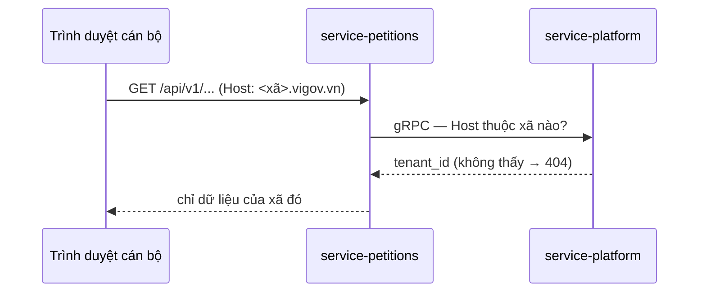

# Skill: Reports a person understands in thirty seconds

**Why this skill exists.** The owner, 12/10/2026: agent reports here read like AI — abstract,
wordy, unclear, short on evidence and diagrams. The reader is the project owner or a supervisor
reading Vietnamese between other work. Within the first two lines they must know **what happened,
whether it is finished, and what they have to do**. Everything after that is evidence they may skip.

`write-knowledge` decides **whether** to write and **where**. This skill decides **how**. Text a
citizen or commune staff member reads on screen follows `administrative-language` instead.

Write as the engineer who did the work and answers for every sentence. Do not add personality,
filler, or ceremony to sound friendly, and do not add artificial flaws to sound human — plain,
specific, verifiable text is what reads as written by a person.

## 1. Shape — the answer comes first

| Order | Content |
|---|---|
| 1 | **One sentence of conclusion**: done · not done · stopped where — plus the one fact that matters (commit, number, blocker) |
| 2 | What changed or was found: a table or ≤ 5 bullets, **each with its evidence** (§2) |
| 3 | What is **not** done, **not** verified, or risky — named plainly, never buried or left out |
| 4 | What the reader must do, if anything: numbered, concrete, one action per line |

Never: an introduction, a restatement of the request, a narrative of how the work went, a closing
summary, an offer of "more help". Ask a question only when a real decision belongs to the reader.

## 2. Evidence — every claim carries one

| Claim | Evidence |
|---|---|
| The code does X | `service-petitions/internal/app/tiep_nhan.go:88` |
| The work is done | commit `54402aa2`, pushed |
| It was tested | the command and its count: `go test ./internal/app` — 42 OK |
| The screen matches | path of the real screenshot next to the prototype's |
| The user decided it | date + their words, quoted |
| A number | where it was measured, and when |

Keep three states apart, in these words:

| State | Write |
|---|---|
| Ran it, or read the exact line | state it plainly, with the evidence |
| Inferred from reading, not run | "theo mã (`file:line`), chưa chạy" |
| Do not know | "chưa biết — cần <ai / việc gì> để biết" |

Never round "chưa kiểm" up to "xong". A red check, a skipped step, a guessed value goes in row 3
of §1, with the output or the reason.

## 3. Pick the form that is fastest to read

| The content is… | Use |
|---|---|
| ≥ 3 items compared on the same attributes | table |
| ≥ 3 steps in a fixed order | numbered list, the command inside the step that uses it |
| A request or data crossing services | sequence diagram |
| A lifecycle, statuses and transitions | state diagram, or a transition table |
| Components and the boundaries between them | flowchart |
| A failure | symptom → cause (evidence) → fix → how it was checked |
| Options for the reader to choose | table: option · gain · cost, then one-sentence recommendation |

A paragraph that describes three related things is a table that has not been drawn yet.

### Diagrams

- **Where it renders.** Mermaid renders in GitHub and in documents; the terminal shows it as raw
  code. In a chat reply use a table or a one-line flow (`trình duyệt → petitions → platform`);
  in `kb/`, ADRs and runbooks use Mermaid.
- Only components that **exist**, named as in the code. A proposed part is labelled `(đề xuất)`.
- ≤ 10 nodes, short Vietnamese labels, every arrow labelled with what crosses it.
- One question per diagram. No diagram that the next sentence repeats in words.

Shape to follow (the flow is real — rule 1 invariant 3; check names before reusing it):



## 4. Sentences

- One idea per sentence; ~25 words at most. Split anything joined by three "và" / "nên" / "—".
- The subject is a concrete thing: a service, file, table, command, person. Not "hệ thống",
  "giải pháp", "quá trình".
- A number instead of an adjective: "36 ca test qua", "chậm 4 giây", "3 trong 7 dịch vụ".
- Active verb, named actor: "petitions từ chối yêu cầu", "bạn cần xoá job trên Jenkins".
- Vietnamese prose; identifiers, paths and commands in backticks, unchanged. Do not mix in an
  English word where a plain Vietnamese one exists.
- Bold only the one or two things the reader must not miss. No emoji. No heading on a reply
  shorter than about fifteen lines.

## 5. AI phrasing — delete on sight

| Sounds like AI | Write instead |
|---|---|
| "Tuyệt vời!", "Chắc chắn rồi!", "Câu hỏi rất hay" | nothing — start with the result |
| "Dưới đây là…", "Sau đây tôi xin trình bày…" | nothing — give the content |
| "Tôi đã hoàn thành thành công…" | "Xong: <việc>." + evidence |
| "nhằm đảm bảo", "giúp tối ưu", "nâng cao hiệu quả" | the mechanism: "khoá (tenant_id, ma) chặn trùng số" |
| "một cách hiệu quả / toàn diện / liền mạch / linh hoạt", "mạnh mẽ", "tối ưu" | delete the adjective, or give the measurement |
| "đóng vai trò quan trọng / then chốt trong…" | say what it does |
| "không chỉ… mà còn…", "từ… cho đến…" used to list | a list, or two sentences |
| "Lưu ý quan trọng:", "Điều đáng chú ý là…", "Cần lưu ý rằng…" | state the thing |
| "Nhìn chung", "Tóm lại", "Tổng kết lại" closing a short report | delete |
| "Hy vọng điều này hữu ích", "Nếu cần thêm gì, cứ cho tôi biết" | delete |
| "có thể", "có lẽ", "dường như" stacked | once, with the reason it is uncertain — or check, then say it flatly |
| "Đầu tiên tôi đọc…, sau đó tôi…, tiếp theo…" | the result; the process only where it is the evidence |
| three adjectives for rhythm ("nhanh, gọn, an toàn") | keep the one you can prove |
| a dash (—) joining every clause | separate sentences |
| "Đây là một bước tiến lớn", "nền tảng vững chắc" | delete — the reader judges |

English (commit messages, code comments): *leverage, seamless(ly), robust, comprehensive, ensure,
streamline, delve, it is worth noting, in summary, empower* — same treatment.

Do not swap words mechanically: rewrite the sentence until it states a fact that can be checked.

## 6. Length

| Text | Target |
|---|---|
| Reply after a small task | 3–8 lines |
| Reply after a multi-part task | conclusion + one table + "chưa làm" + "bạn cần làm" — about 25 lines |
| Subagent report to the main session | the headings the agent defines; one line per finding, each with `file:line` |
| Ledger item (`kb/90-ephemeral/tien-do/`) | `viec` 1–2 sentences · `bang_chung` commits + commands + counts · `tiep_theo` numbered steps |
| Commit message | subject says what changed (~100 characters); body: why, then what was checked and what was not |
| `kb/` document, ADR, runbook | as long as the decision or the procedure needs; no section without a distinct question |

The cut test, sentence by sentence: if deleting it loses nothing the reader needs, delete it.
Never cut a safety step, a failure, or a rollback to make the text shorter.

## 7. Frames

**A. Reply after changing code**

```
<Một câu kết luận: xong gì / dừng ở đâu>. Commit `abc1234`, đã push.

| Việc | Bằng chứng |
|---|---|
| <việc> | `đường/dẫn.go:12` · `go test ./...` 18/18 |

Chưa làm / chưa kiểm: <việc> — vì <lý do>.
Bạn cần: 1. <việc cụ thể>
```

**B. Review** — findings ranked by severity, a table `Mức · Vị trí (file:line) · Lỗi · Sửa`; then
one line naming what was checked and is fine.

**C. Proposal** — the problem in one sentence with evidence; `Phương án · Được · Mất`; the
recommendation in one sentence; the question the reader must settle.

**D. Investigation** — `Triệu chứng` (what was seen, where) → `Nguyên nhân` (`file:line`, log line)
→ `Sửa` (commit) → `Đã kiểm` (command + result).

**E. Runbook in `kb/40-runbooks/`** — frontmatter of tier T4 (`write-knowledge`), then:
`Khi nào dùng` · `Ảnh hưởng và điều cấm` · `Kiểm trước` · `Các bước` (command + expected output per
step) · `Kiểm sau` · `Quay lui / báo ai`. An undocumented rollback is written as such — "chưa có
cách quay lui đã kiểm — không tự ứng biến" — never left blank.

## 8. Before and after

Before (the shape to avoid):

> Tôi đã hoàn thành việc gỡ bỏ chức năng vigov-van-hanh một cách toàn diện nhằm đảm bảo hệ thống
> gọn gàng và dễ bảo trì hơn. Dưới đây là tóm tắt những thay đổi quan trọng. Nhìn chung, các phần
> liên quan đã được cập nhật đầy đủ và mọi kiểm tra đều đã vượt qua. Hy vọng điều này hữu ích!

After:

> Đã gỡ job `vigov-van-hanh` — commit `54402aa2`, đã push.
>
> | Việc | Bằng chứng |
> |---|---|
> | Xoá `deploy/van-hanh/` (Jenkinsfile, ops.py, test, README) | `54402aa2` |
> | `nen-ban-do` của `vigov-deploy` chuyển sang `deploy/basemap/` | `deploy/Jenkinsfile:2174` · `test_basemap.py` 11/11 |
>
> Chưa kiểm: chạy thật `nen-ban-do` trên Jenkins.
> Bạn cần: xoá job `vigov-van-hanh` trên Jenkins (Delete Pipeline).

The second is shorter, and every line can be checked.

## 9. Before sending

1. Does line 1 say whether it is done, and what the result is?
2. Does every claim carry evidence, or say "chưa kiểm"?
3. Is there a paragraph that should be a table, a list or a diagram?
4. Is any phrase from §5 left?
5. Can a sentence be deleted without loss? Delete it.
6. Is a failure, a skipped step or a guess hidden or pushed to the end? Move it up.
7. Does the reader know exactly what to do next — or that nothing is needed?
8. No secret, no personal data (rules 3 and 8).

→ `write-knowledge` (whether · where) · `administrative-language` (text on screen) · rule 9
