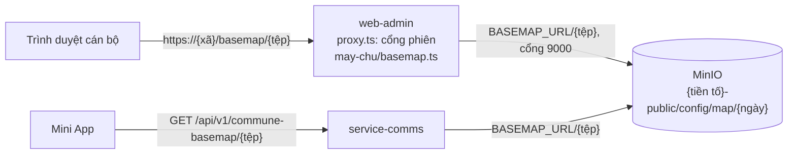

# Nền bản đồ tự host (PMTiles) — dựng, làm mới, xử lý sự cố

Dùng chung cho bản đồ phản ánh (`/phan-anh`) và, từ 11/10/2026, Bản đồ kinh tế số (`/ban-do`) — ADR 0072
§Sửa đổi 11/10/2026. Thiếu nền thì cả hai cùng hiện câu "Chưa cấu hình bản đồ nền"; Sổ địa điểm của
`/ban-do` vẫn dùng được.

**Vì sao có nền tự host, phạm vi tệp, ai quyết:** ADR 0072 §Sửa đổi 09/10/2026 và §Trả lời 09/10/2026
(`kb/10-decisions/0072-ban-do-kinh-te-so-nen-tu-host.md`). Tệp này chỉ nói **làm thế nào**. Khung
bbox, mức thu nhỏ và mức phóng to cố định trong `web-admin/scripts/build-basemap.sh` (đầu tệp có lý
do từng con số) — không chép lại ở đây.

| Khi nào dùng | Ảnh hưởng | Điều cấm |
|---|---|---|
| Bản đồ không có nền / lỗi 404·502·504 ở `/basemap/`; làm mới tệp nền; đổi MinIO | Đặt sai `BASEMAP_URL` làm cả hai bản đồ mất nền; các phần khác của web-admin và comms vẫn chạy | Đưa vào dùng khi **chưa có danh mục kiểm chủ quyền đã ký** · dùng URL OpenFreeMap hay host ngoài · ghi đè tiền tố đang được đọc mà **không** kiểm và ký lại sau đó · tắt kiểm chứng chỉ MinIO |

Đường đi của một byte nền bản đồ:



Mỗi tiền tố ngày chứa **hai** tệp nền: `vn-mainland.pmtiles` (Protomaps/OSM) và, từ 12/10/2026,
`vn-places.pmtiles` (địa điểm Overture Maps — ADR 0072 §Sửa đổi 12/10/2026). web-admin và comms phát cả hai
theo **đúng tên** (danh sách đóng), từ cùng `BASEMAP_URL`. Danh sách tệp web-admin phát:
`web-admin/src/lib/basemap/assets.ts`; comms: `service-comms/internal/http/commune_basemap.go`. Nhánh Mini App:
`deploy/cau-hinh/README.md` mục `BASEMAP_URL` (comms trả 503 khi thiếu khoá).

## Triệu chứng → việc làm

| Thấy gì | Nguyên nhân thường gặp | Làm gì |
|---|---|---|
| Bản đồ phản ánh hoặc `/ban-do` hiện **"Chưa cấu hình bản đồ nền."**; `/basemap/...` trả 503 | Key `BASEMAP_URL` chưa có trong `common-config`, hoặc sai dạng (không https, có thông tin đăng nhập, có truy vấn). Log pod web-admin có **một** dòng gọi tên biến | Mục "Đưa vào dùng" |
| `/basemap/vn-mainland.pmtiles` trả **404** "Không tìm thấy tệp bản đồ nền." | Tiền tố trong `BASEMAP_URL` sai ngày, hoặc chưa tải lên | `mc ls <alias>/<bucket>/config/map/` — đối chiếu tên thư mục ngày với giá trị key |
| Bản đồ có nền nhưng **không có chấm/tên địa điểm** ở z13 trở lên; `/basemap/vn-places.pmtiles` (hoặc `/api/v1/commune-basemap/vn-places.pmtiles` của comms) trả **404** | Tiền tố trong `BASEMAP_URL` không có tệp địa điểm: dựng trước 12/10/2026, hoặc trỏ sai ngày. Đây là **chủ ý** — lớp địa điểm là nguồn tuỳ chọn, thiếu nó bản đồ vẫn vẽ, **không** hiện câu "Chưa cấu hình" (`isOptionalBasemapSourceError`, `web-admin/src/lib/basemap/style.ts`) | Chạy lại việc `nen-ban-do` có `BAN_OVERTURE`, với `NGAY_NEN` mới; kiểm chủ quyền có ký; rồi đổi `BASEMAP_URL` sang tiền tố mới (mục "Đưa vào dùng") |
| Trả **502** | MinIO trả 403 (bucket không cho đọc ẩn danh), chứng chỉ MinIO do CA nội bộ ký mà pod không tin, hoặc NetworkPolicy chặn | Lần lượt: `mc anonymous get <alias>/<bucket>` phải in `download`; CA nội bộ → mount CA và đặt `NODE_EXTRA_CA_CERTS` cho web-admin (**không bao giờ** tắt kiểm chứng chỉ); `kubectl get networkpolicy allow-web-admin-egress-storage` phải có, và cổng trong key phải là 9000 |
| Trả **504** | MinIO không phản hồi trong 30 giây | Kiểm MinIO; không phải lỗi web-admin |
| Bản đồ trắng, không câu nào, tab Network không có `/basemap/` | Trang gọi `new Map` trước `registerPmtilesProtocol` (`web-admin/src/lib/basemap/protocol.ts`) | Lỗi mã — báo người dựng màn |
| Bản đồ trắng sau khi bật CSP | CSP thiếu nguồn | Cần `connect-src 'self'`, `img-src 'self' data: blob:`, `worker-src 'self' blob:` — ghi ở nợ `missing-security-headers`, `tools/security_debt.json` |

**Kiểm từ trong cụm** (pod gỡ lỗi cùng namespace, không từ máy cá nhân):

```sh
curl -sI -H 'Range: bytes=0-126' "<giá trị BASEMAP_URL>/vn-mainland.pmtiles"   # phải: 206, Content-Range: bytes 0-126/<cỡ tệp>
curl -sI -H 'Range: bytes=0-126' "<giá trị BASEMAP_URL>/vn-places.pmtiles"     # như trên; 404 = tiền tố thiếu lớp địa điểm
```

## Dựng lần đầu hoặc làm mới

Bước 2–3 (dựng + tải lên) chạy theo **một trong hai** cách — **không bao giờ** trong pod:

- **Job Jenkins, việc `nen-ban-do`** (chủ dự án chốt 11/10/2026) — job `vigov-deploy`
  (`HANH_DONG=nen-ban-do`), chạy `deploy/basemap/basemap-task.sh`. Việc chạy
  trên máy build, tự tải `pmtiles` + `mc` đã ghim SHA-256, kéo/dựng ảnh DuckDB + tippecanoe đã ghim
  digest/commit cho lớp địa điểm (tham số `BAN_OVERTURE`), lấy bucket và địa chỉ từ `common-config` của
  `MT`, dùng cặp khoá MinIO **có sẵn** của `comms-secrets` (thiếu thì `platform-secrets`), in dòng
  SHA-256, `BUILD-INFO.txt` và giá trị `BASEMAP_URL` để ghi vào danh mục ký. Job **không** đổi
  `BASEMAP_URL`. Máy build cần gì, mã băm công cụ: `deploy/README.md` mục `nen-ban-do`.
- **Bằng tay** trên máy người vận hành có Internet, `pmtiles` (go-pmtiles v1.31.2), `curl`, `mc` có alias
  tới MinIO của ViGov, `docker` và hai ảnh đã ghim (DuckDB; tippecanoe dựng từ
  `deploy/basemap/tippecanoe.Dockerfile`) — tham chiếu ảnh in bởi `deploy/basemap/basemap.py images`, cách
  kéo/dựng xem `deploy/basemap/basemap-task.sh`. Các lệnh ở bước 2–3 dưới.

1. **Chọn bản dựng:** một ngày `YYYYMMDD` có ở `https://build.protomaps.com/<YYYYMMDD>.pmtiles`
   (Protomaps chỉ giữ các ngày gần đây). Script tự từ chối bản dựng có lược đồ tile khác v4. Và một bản
   phát hành Overture dạng `2026-09-23.1` (Overture chỉ giữ vài bản gần nhất —
   `https://stac.overturemaps.org/catalog.json`).
2. **Dựng:** `DUCKDB_IMAGE=<ảnh>@sha256:<digest> TIPPECANOE_IMAGE=<ảnh tippecanoe> web-admin/scripts/build-basemap.sh build --date <YYYYMMDD> --overture <bản> --out <thư mục>`
   — cắt vùng (vài GB), tải glyph + sprite ở commit đã ghim, cắt lớp địa điểm Overture thành
   `vn-places.pmtiles` (script tự từ chối khi biên đông của tệp vượt khung), ghi `BUILD-INFO.txt` +
   `SHA256SUMS` phủ cả hai tệp. Xem trước câu SQL sẽ chạy:
   `web-admin/scripts/build-basemap.sh places-sql --overture <bản>`. Bộ lọc địa điểm và lý do: đầu tệp script.
3. **Tải lên:** `web-admin/scripts/build-basemap.sh upload --date <YYYYMMDD> --out <thư mục> --alias <alias> --bucket <bucket>`.
   Tiền tố mới `config/map/<YYYYMMDD>/` trong bucket (chủ dự án chốt 11/10/2026; không liên quan tuyến
   `/basemap/*` của web-admin). Nhập lại **cùng ngày** thì **ghi đè** tiền tố đó (chủ dự án, 12/10/2026),
   có in cảnh báo. Nếu `BASEMAP_URL` đang đọc chính tiền tố ấy: bản đồ đang mở có thể vỡ ô tới khi tải
   lại trang, và danh mục ký của tiền tố hết khớp SHA-256 — kiểm và ký lại. Làm mới an toàn vẫn là ngày
   **mới**. Tải lên **chưa** phải đưa vào dùng — job không đổi `BASEMAP_URL`.
4. **Kiểm chủ quyền có ký** — mục dưới. Không ký thì dừng ở đây.
5. **Đưa vào dùng** — mục dưới.

**Bucket:** đề xuất của người dựng là bucket `<tiền tố>-public` đã có (đọc ẩn danh, `deploy/cau-hinh/README.md`
mục "Bucket media công khai"): web-admin không giữ bí mật nào, nên chỉ đọc được bucket cho đọc ẩn danh.
Hệ quả: ai biết địa chỉ MinIO công khai cũng tải được tệp nền (dữ liệu OSM công khai, nhưng tốn băng
thông). Muốn bucket riêng có khoá thì web-admin phải giữ khoá MinIO — chủ dự án quyết.

## Kiểm chủ quyền — BẮT BUỘC sau MỖI lần làm mới

ADR 0072 §Trả lời 09/10/2026: kiểm tay + danh mục kiểm **có ký**, mọi lần, không ngoại lệ. Kiểm trên
**staging** đã trỏ `BASEMAP_URL` vào tiền tố mới (mục "Đưa vào dùng", bước 1), bằng màn bản đồ phản ánh
thật, ở các xã có khung chạm biển và biên giới.

| # | Kiểm | Đạt khi |
|---|---|---|
| 1 | `pmtiles show <tệp>` | `min zoom` = 8, `max zoom` = 15, bounds trong khung của script |
| 2 | Kéo, thu nhỏ hết mức ở một xã ven biển miền Trung và một xã ven biển Kiên Giang | Không thấy Hoàng Sa, Trường Sa, không thấy đường nào trên biển |
| 3 | Vịnh Bắc Bộ, vùng biển Tây Nam, biên giới Việt–Trung, Việt–Lào, Việt–Campuchia | Không có đường ranh giới tranh chấp hay ranh giới biển nào |
| 4 | Tên biển, vịnh, đảo gần bờ (Bạch Long Vĩ, Cô Tô, Cồn Cỏ, Lý Sơn, Phú Quý, Côn Đảo, Phú Quốc, Thổ Chu) | Hiện bằng tiếng Việt; không có tên tiếng Anh hay tiếng Trung thay chỗ tên Việt |
| 5 | Đảo gần bờ vẫn có trên nền | Có hình đảo và tên |
| 6 | Góc bản đồ | Có dòng ghi nguồn `Protomaps © OpenStreetMap contributors` |
| 7 | `SHA256SUMS` trên MinIO | Khớp tệp đã dựng (`mc cat …/SHA256SUMS`) |

Lớp địa điểm `vn-places.pmtiles` (ADR 0072 §Sửa đổi 12/10/2026). Vùng quốc gia VN của chính Overture đã
không gồm Hoàng Sa, Trường Sa (biên đông khoảng 109,67°E), nhưng chốt chặn chính vẫn là khung BBOX của script.

| # | Kiểm | Đạt khi |
|---|---|---|
| 8 | `pmtiles show vn-places.pmtiles` | `min zoom` = 13, `max zoom` = 15, bounds trong khung của script |
| 9 | `BUILD-INFO.txt` | Có `places_source`, `places_filter=confidence>=0.5 country=VN cjk=dropped`, `places_zoom=13-15`, `places_features` |
| 10 | Phóng z13–15 ở một xã ven biển miền Trung và một xã ven biển Kiên Giang | Không chấm địa điểm nào trên biển ngoài đảo gần bờ; không chấm nào ở Hoàng Sa, Trường Sa; không chấm nào phía đông khung |
| 11 | Tên địa điểm | Không có chữ Hán. Tên chữ Hangul/Kana được bộ lọc đã chốt **giữ lại** — thấy thì ghi vào danh mục và báo, chủ dự án quyết |
| 12 | Vùng dày (Hà Nội, TP.HCM) ở z15 | Vẫn thấy chấm địa điểm |
| 13 | Góc bản đồ | Có `© Overture Maps Foundation` cạnh dòng ghi nguồn OSM |
| 14 | `SHA256SUMS` trên MinIO | Dòng của `vn-places.pmtiles` khớp tệp đã dựng |

**Danh mục ký:** ghi ngày bản dựng, `BAN_OVERTURE`, giá trị `BASEMAP_URL`, dòng SHA-256 của **cả hai**
tệp `vn-mainland.pmtiles` và `vn-places.pmtiles`, kết quả từng dòng 1–14, người kiểm, người duyệt, ngày ký. Bản ký lưu ở **hồ sơ vận hành ngoài kho mã** — không
commit (tên người ký không thuộc kho). **Ai ký** sau lần chạy thật đầu tiên: chủ dự án chưa nêu tên —
trước lần chạy thật đầu tiên là pháp chế ViHAT + đầu mối UBND (ADR).

Một dòng không đạt: **không** đưa vào dùng; giữ `BASEMAP_URL` cũ; báo chủ dự án. Không sửa style hay
khung để "cho qua" — đó là điểm dừng của ADR 0072.

## Đưa vào dùng và quay lui

1. Staging: đặt key `BASEMAP_URL` = `https://<MinIO nội bộ>:<cổng>/<bucket>/config/map/<YYYYMMDD>` trong
   `common-config` của `vigov-staging` — `kubectl -n vigov-staging edit configmap common-config` — rồi
   `kubectl -n vigov-staging rollout restart deploy/vigov-web-admin`: key trùng tên biến, tới pod qua
   `envFrom`, mà `envFrom` chỉ đọc lúc pod khởi động (ADR 0093). Kiểm, ký.
2. Prod: cùng giá trị ở `vigov-prod`, rồi `rollout restart` như bước 1.
3. **Quay lui:** đặt lại giá trị cũ, `rollout restart` lại. Vì vậy **không xoá** tiền tố cũ ngay — giữ ít nhất tới
   lần làm mới sau.

Nhịp làm mới: **chưa chốt** (ADR 0072, việc còn mở #3 sau trả lời). Đề xuất của ADR: khi xã báo sai đường
hoặc tên, hoặc hằng năm.

## Ghi nguồn ODbL và Overture

Dữ liệu là OpenStreetMap (giấy phép ODbL). Style mang dòng ghi nguồn ở nguồn tile
(`BASEMAP_ATTRIBUTION`, `web-admin/src/lib/basemap/style.ts`); MapLibre hiện nó ở góc bản đồ. **Không
được gỡ**, kể cả khi màn hẹp. Câu chữ pháp lý đầy đủ và xác nhận pháp lý về thể hiện chủ quyền vẫn là
việc còn mở của ADR 0072.

Lớp địa điểm là dữ liệu Overture Maps (giấy phép CDLA-Permissive-2.0), mang dòng ghi nguồn riêng ở nguồn
tile của nó (`PLACES_ATTRIBUTION`, cùng tệp). Lời văn hiện tại là **đề xuất, chờ pháp chế duyệt** — ADR 0072
§Sửa đổi 12/10/2026 mục O5; đổi lời văn thì sửa ADR trước, mã sau. Không được gỡ, như dòng OSM.
